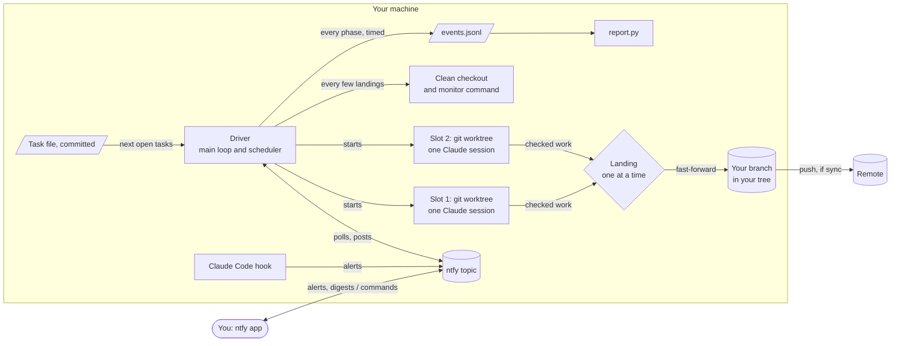
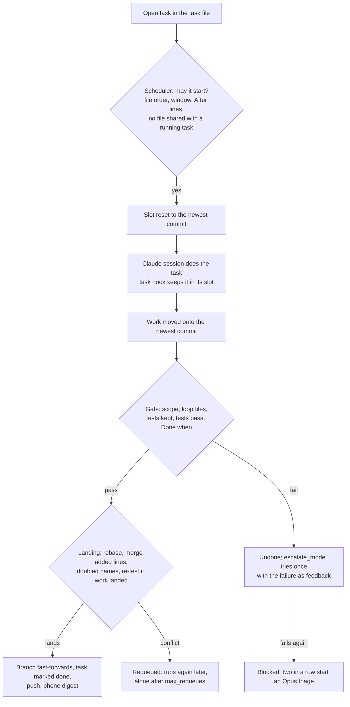

# ntfy-er

Run a queue of coding tasks with Claude Code while you are away, and steer it from your phone. The **driver** works
through a task file, one Claude session per task, several side by side in git worktrees, and lands only work that
passes its own checks. Your phone gets a digest of what landed and an alert when something needs you, through
[ntfy](https://ntfy.sh); you answer with a word (`STATUS`, `PAUSE`, `APPROVE ...`).

Nothing here names a project. Paths, the test command and the patterns the checks use all come from one config file.

| Part | Folder | What it does |
|---|---|---|
| Loop driver | `runner/driver/` | Runs the task queue: schedules, runs sessions, checks, lands, pushes, answers the phone. |
| Phone hook | `hook/` | A Claude Code hook that alerts on permission prompts and on `LOOP_DONE` / `NEED_INPUT` lines. |
| Loop template | `loop-template/` | The loop file (with the driver's settings block), the review guide and a plan template. |
| Worker runner | `runner/worker_task.py` | Hands one task to a local model through Claude Code and watches it ([docs](docs/worker-runner.md)). |

## How it works

- **Your tree is yours.** Tasks run in worktrees under `slots_dir`, never in your working copy, so you can edit while
  the driver runs. It reads only committed work, and it never overwrites an uncommitted file of yours: when one is in
  the way it waits and tells you which.
- **Side by side, safely.** `parallel_slots` tasks run at once. A task waits while a running task holds one of its files
  (its **Files.** line, plus files its session takes), names it, or is named by its **After.** line. A hook refuses a
  session's edits to another slot's files. Reviews and other **Who.** Opus tasks run alone.
- **Only checked work lands.** The driver runs the tests itself and checks the scope, removed or weakened tests, and
  the task's **Done when.** line. Work that landed meanwhile is merged in and tested again before anything lands.
- **It looks after itself.** A supervisor restarts it after a crash; it pauses at the usage limit or the daily budget
  and resumes on its own; blocks in a row start an Opus triage; every few landings a fresh checkout is tested.

## Set up

1. **A phone topic.** Install the ntfy app, make a random topic name (16+ characters), subscribe to it, and put the
   name alone in `~/.claude/hooks/ntfy-topic.txt`. Optionally reserve it with an access token in
   `~/.claude/hooks/ntfy-token.txt`.
2. **The hook** (optional): copy `hook/phone.ps1` to `~/.claude/hooks/`, and merge `hook/settings-hooks.example.json`
   into `~/.claude/settings.json`. [Details and tests](docs/hook-and-troubleshooting.md).
3. **The config.** Copy `runner/worker.example.json` to `worker.json` (or point `WORKER_CONFIG` at it) and set at
   least `project_root`, `scope` and `test_command`. The keys that matter most:

   | Key | What it is |
   |---|---|
   | `scope` | Folders a task may change, e.g. `["src", "tests"]` |
   | `test_command` | Runs the tests from the tree's root; must print a line with `totals_marker` and `pass_marker` |
   | `test_files` | Globs of the test files, for the removed-test and weakened-test checks |
   | `tasks_file`, `progress_file`, `loop_file`, `rules_file`, `design_file` | The loop's files |
   | `slot_files`, `cache_dirs` | Per-slot files (a tool's per-project data folder) and caches a fresh clone lacks |
   | `monitor_command` | Optional longer check (a benchmark, a bot) run every `monitor_every` landings |
   | `sync` | Push after each landing |

   Every key the driver reads is in `runner/driver/loop_common.py` (`CONFIG_DEFAULTS`).
4. **The loop file.** Copy `loop-template/LOOP.md` into your project (at `loop_file`); its `driver-settings` block holds
   the settings you change while it runs: `parallel_slots`, `daily_budget_usd`, `approvals`, `commit_digest`, ...
5. **Tasks.** Each `### [ ] <id> <title>` heading in the task file is a task, with a **Files.** and a **Done when.**
   line (see the loop template).

## Run it

From the folder that holds `worker.json`:

| Command | What it does |
|---|---|
| `python runner/driver` | Starts the driver under its supervisor |
| `python runner/driver/check_driver.py` | Is it running, on what, and its last log lines |
| `python runner/driver/simulate.py` | What `parallel_slots` and `parallel_window` would do to your queue |
| `python runner/driver/report.py` | Where the time and money went: phases, idle slots by reason, failures, friction |
| `python runner/driver --shutdown` | Stops everything now; unfinished work in the slots is undone |
| `python runner/driver --install-autostart` | Starts it at each logon (Windows), or prints a crontab line |

**Phone commands** (the whole message, any case): `STATUS`, `MAN`, `PAUSE` / `STOP`, `RESUME`, `WIND DOWN` (end after
the running tasks), `SHUTDOWN NOW`, `MODEL <haiku|sonnet|opus|fable> [effort]`, `APPROVE <code>` / `DENY <code>`,
`OPUS: <question>` (a read-only answer as a file), `OPUS WRITE: <instruction>` (a tested change).

**Logs**, in `logs_dir`: `events.jsonl` (every phase of every task, timed: what `report.py` reads), `driver.log` (every
decision, in words), `usage.jsonl` (every session's tokens and cost), each session's stream and each gate's test
output in files of their own, and `revert-*/` folders (undone work, with a `REASON.txt`).

## Safety

- The topic name is a password: anyone who knows it can read alerts and send commands. Use a token to lock it.
- Alert text passes through ntfy.sh. Keep secrets out of task output, or self-host ntfy.
- Task sessions can run shell commands. Git commands that change history are denied, the task hook keeps sessions in
  their own worktree, and nothing lands without the gate, but the shell is not sandboxed.
- With `approvals: on`, automated Opus and Fable calls wait for your `APPROVE`. `daily_budget_usd` caps a day's spend.

More: [troubleshooting and the hook](docs/hook-and-troubleshooting.md), [the loop template](docs/loop-template.md),
[the worker runner](docs/worker-runner.md), and the driver's own documentation at the top of
`runner/driver/__main__.py`.
